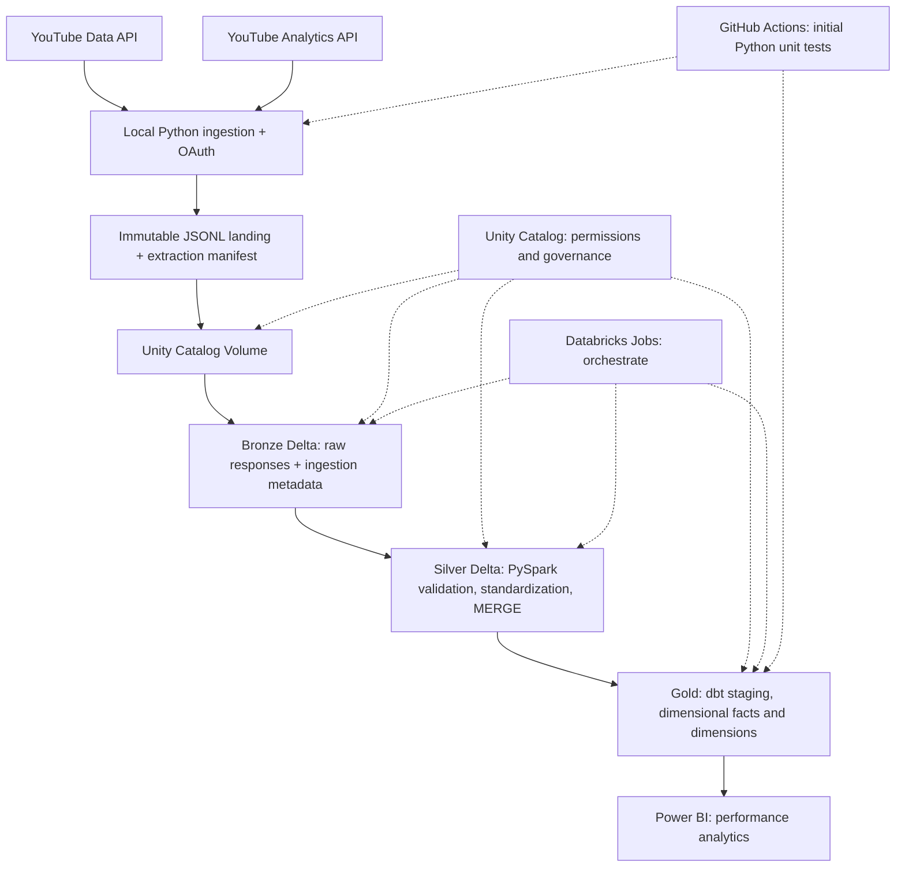

# Architecture — Sanchari Analytics Lakehouse

## Layer boundaries

| Layer | Input | Output | Deduplication grain |
| --- | --- | --- | --- |
| Landing | Google API JSON | JSONL + manifest per extract | no rewrite; immutable file names |
| Bronze | JSONL files | append-only Delta / source lineage | retain raw, duplicated extracts possible |
| Silver metadata | Bronze videos | normalized video metadata | `video_id` for current state |
| Silver snapshots | Bronze statistics | statistics snapshots | `video_id`, `captured_at_utc` |
| Silver daily | Bronze analytics | daily metrics | `video_id`, `date`, and any selected dimensions |
| Gold | Silver | dashboard-ready star schema | fact and dimension contracts |

## Flow and failure handling

1. The extractor fetches pages with bounded retries and backoff. Missing permissions and exhausted quotas are explicit failures, not silent empty results.
2. Every extraction has a manifest (`extract_run_id`, endpoint, source window, extraction timestamp, record count) and immutable source files.
3. Bronze captures raw payload and processing metadata to enable source-level replay.
4. Silver performs schema validation, deduplication and idempotent updates. Bad rows are quarantined with an error reason.
5. Analytics can revise prior days. Scheduled loads re-read a trailing lookback window; MERGE updates by exact grain.
6. dbt tests include uniqueness, not-null, and cross-table relationships; only validated Gold models are exposed to the dashboard.
7. Orchestration logs step status, record counts, watermark, retry count and error category.

## Out-of-scope / feature flags

- Free Edition is *not* enterprise production: no SLA or paid Azure infrastructure assumptions.
- Autoloader, direct API egress from serverless, dbt CLI warehouse access, scheduled Jobs and Power BI connection need live workspace validation.
- A fallback batch `COPY INTO` or Spark read remains available if Auto Loader integration cannot be configured.
